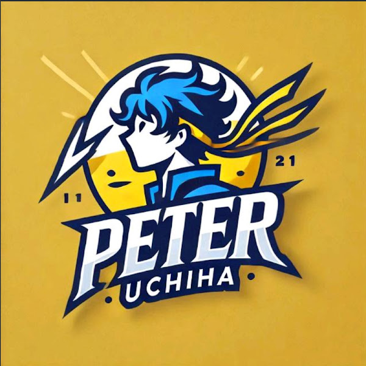

# Peter Auto Clicker

A free Windows mouse recorder and auto clicker. It records the exact path and pace of your mouse (movements, clicks, scrolling and drags) and replays it once, a set number of times, or forever.

## Download

Get **PeterAutoClicker-v1.2.zip** from the [latest release](../../releases/latest), unzip it, then run `PeterAutoClicker.exe`.
Nothing to install, and it works fully offline.

> The first time you open it, Windows may say *"Windows protected your PC"* because the app is new and not code-signed. Click **More info**, then **Run anyway**.

## How to use

| Button | Default key | What it does |
|---|---|---|
| **Record** | F6 | Start recording. Press again to finish |
| **Play** | F7 | Play the recording (after a 3, 2, 1 countdown) |
| **Stop** | F8 | Stop |

| Setting | Meaning |
|---|---|
| **Repeat** | How many times to play it. The infinity button loops forever |
| **Pause** | Wait time between loops, in milliseconds |
| **Speed** | 1 = real pace, 2 = twice as fast, 0.5 = half speed |
| **Mode: Precise** | Replays every movement at the exact recorded pace |
| **Mode: Smart** | Use if it lags. Keeps the rhythm and never misses a click |
| **Auto-stop** | Stops playback when you move the mouse yourself |
| **Hide** | Minimizes the window while it runs |
| **Save / Open / Delete** | Manage your recordings |
| **Pin, Moon, Gear** (top right) | Keep on top, dark mode, settings |

In **Settings** you can change the three hotkeys, turn click sounds on or off, and turn the countdown on or off. Hover over any button in the app for a short tip.

## Good to know

- Only the mouse is recorded, not the keyboard.
- Some online games don't allow auto clickers. Check a game's rules before using it there.
- To click inside programs running as Administrator, run the app as Administrator too.
- Settings and your last recording are stored in `%APPDATA%\PeterAutoClicker`.

---

Free to download and use. © 2026 josiah345, all rights reserved: please don't re-upload or sell it. See [LICENSE](LICENSE). Built with Go; icons by Lucide ([notices](THIRD_PARTY_NOTICES.txt)).

For developers: see [BUILDING.md](BUILDING.md).
